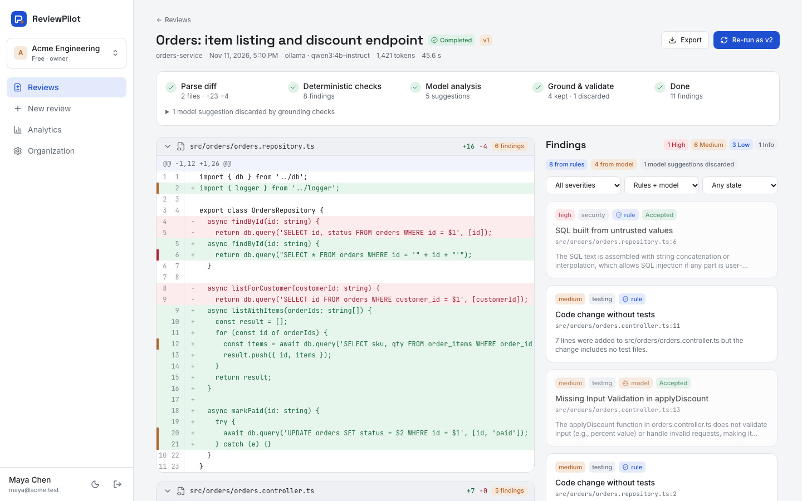
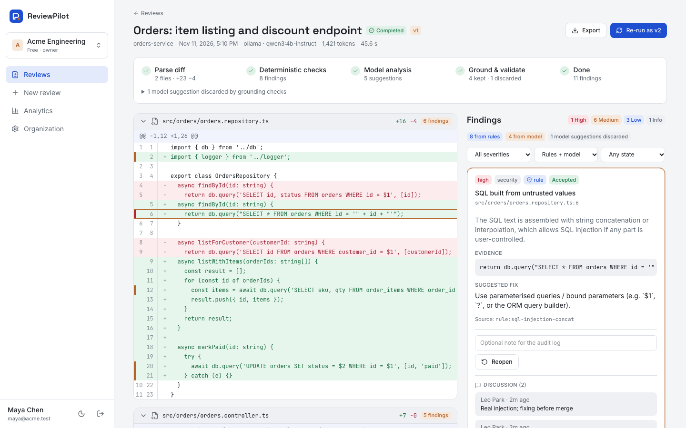
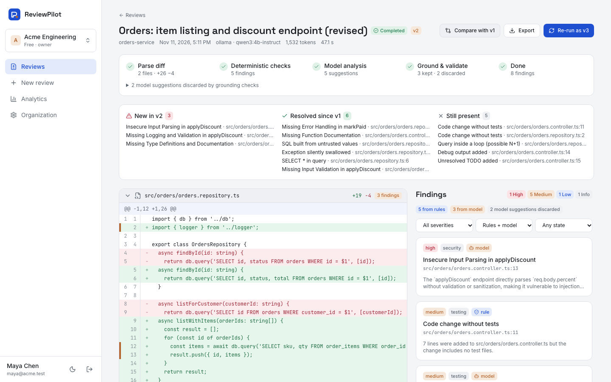
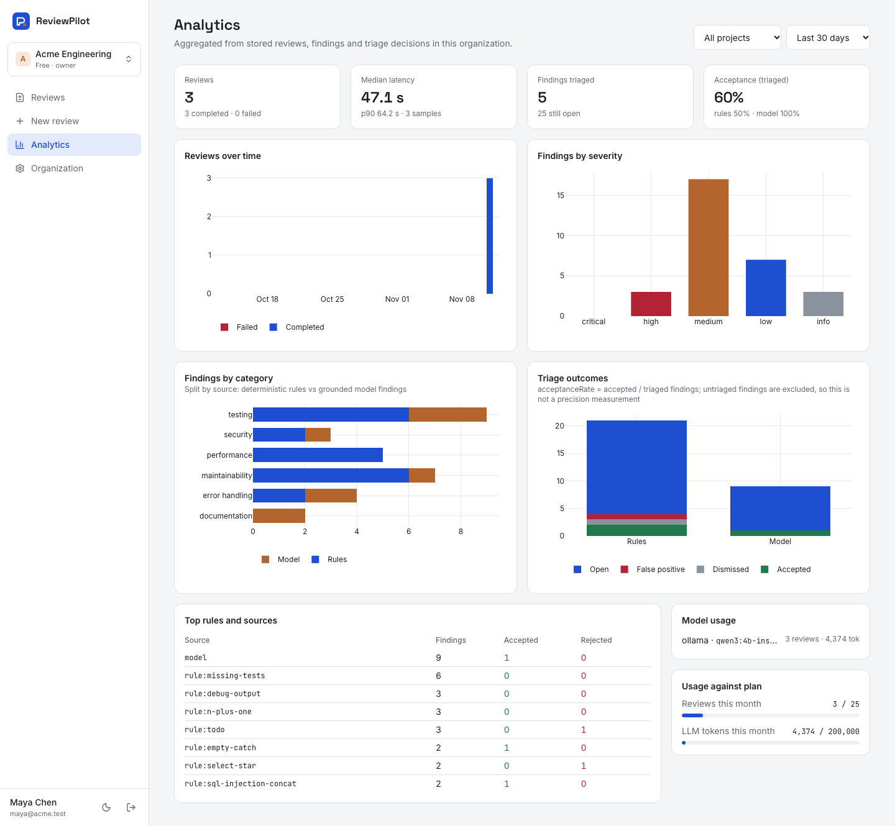
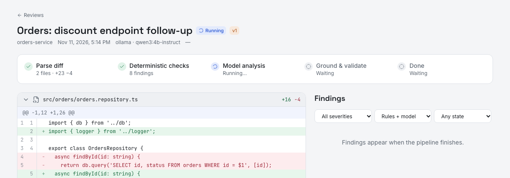

# ReviewPilot

**Code review that shows its evidence.** A multi-tenant generative-AI code-review SaaS. Teams
submit diffs; deterministic checks and a local LLM review them. Every model finding must quote the
exact lines it cites or it is discarded. Reviewers triage, discuss and compare versions while usage
is metered against plan limits.



## What it does

- **Organizations and roles:** sign-up, email-bound invitations, OWNER / ADMIN / REVIEWER / VIEWER, audit log. Cross-tenant access returns 404 everywhere.
- **Reviews:** paste, upload or webhook a unified diff. 17 deterministic rules (secrets, injection, TLS, weak hashes, swallowed errors, N+1, missing tests…), then a model pass whose findings are **grounded** against the diff. Live progress streams over SSE from a BullMQ worker.
- **Workflow:** accept / dismiss / false positive / reopen with notes, comment threads, versions with revised diffs and compare (new, resolved, still present), and export to JSON / CSV / Markdown / SARIF 2.1.0.
- **SaaS plumbing:** plan limits enforced server-side, usage metered from stored records (reviews, LLM tokens, processing time), **mock** plan changes that never charge, analytics, org API tokens, an HMAC-signed CI webhook, idempotent submissions and retention.

| | |
|---|---|
|  |  |
|  |  |

## Run it

```bash
make db && make setup && make migrate     # Postgres :55503 + Redis :56503 (compose project "reviewpilot")
cp .env.example backend/.env
ollama pull qwen3:4b-instruct             # or LLM_PROVIDER=fixture (labelled, offline)
make dev-api                              # API + worker on :8113
cd frontend && npm ci && npm run dev -- --port 3103
cd backend && npm run demo:seed           # optional demo data through the public API
```

Or the whole stack in containers: `docker compose --profile app up --build`. See
[docs/DEMO.md](docs/DEMO.md) and [docs/DEPLOYMENT.md](docs/DEPLOYMENT.md).

## Stack

NestJS 12 · Prisma 7 / PostgreSQL 16 · BullMQ / Redis 7 · Zod · argon2id sessions · Next.js 16 ·
React 19 · TanStack Query · Tailwind 4 · Plotly · Ollama (`qwen3:4b-instruct`) · Vitest ·
Playwright · GitHub Actions.

## Tests

Backend unit 43 · backend integration 63 (real Postgres + Redis) · frontend unit 8 · Playwright
journeys 9 (the 12-step demo, including tenant isolation). Details: [docs/TESTING.md](docs/TESTING.md).

## Honest limits

- The model is a local 4B model. It proposes findings; grounding only proves the quoted code exists on the cited lines, not that the finding is correct. Triage outcomes are reported as an acceptance rate over **triaged** findings, not as precision.
- One manual observation, not an evaluation: on the sample diff, the first strict validator rejected all 5 qwen3:4b suggestions because the model echoed line labels. After the fix, 4 were kept and 1 was rejected ([details](docs/REVIEW_ORCHESTRATION.md)).
- Billing is a mock and mail is a development transport. ReviewPilot never writes to Git hosts. There is no MFA or SSO. No cloud deployment was performed.

## Docs

[Architecture](docs/ARCHITECTURE.md) · [Multi-tenancy](docs/MULTI_TENANT.md) ·
[Review orchestration](docs/REVIEW_ORCHESTRATION.md) · [Usage metering](docs/USAGE_METERING.md) ·
[CI / Git-host integration security](docs/GITHUB_INTEGRATION_SECURITY.md) · [Security](docs/SECURITY.md) ·
[API](docs/API.md) · [Testing](docs/TESTING.md) · [Demo](docs/DEMO.md) ·
[Deployment](docs/DEPLOYMENT.md) · [Decisions](docs/DECISIONS.md) · [Plan](PLAN.md) · [Progress](PROGRESS.md)
