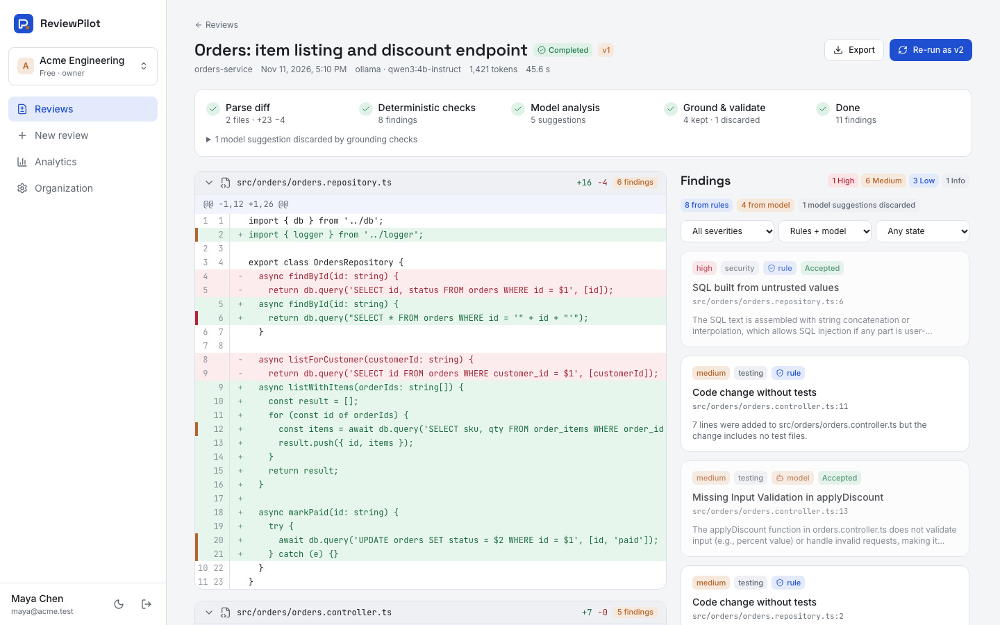

# Demo

```bash
make db                                   # Postgres :55503, Redis :56503 (compose project "reviewpilot")
make setup && make migrate
cp .env.example backend/.env              # DEV_MAIL_OUTBOX=true for the local mailbox
ollama pull qwen3:4b-instruct             # or set LLM_PROVIDER=fixture for an offline demo
make dev-api                              # :8113 (also runs the BullMQ worker)
cd frontend && npm ci && npm run dev -- --port 3103
cd backend && npm run demo:seed           # ~2 minutes with the local model
```

The seed signs up `maya@acme.test` (owner), invites `leo@acme.test` (reviewer) through the dev
outbox, creates projects, reviews the sample diff with the live model, triages and comments as
the reviewer, submits a revised version that fixes two defects, and creates a second organization
(`sam@globex.test`). The demo password is `DEMO_PASSWORD` in `backend/scripts/seed-demo.mjs`. It is
for local use only.

## 12-step walkthrough (automated in `frontend/e2e/journeys.e2e.ts`)

1. Sign up and create an organization.
2. Create a project and load the sample diff (it plants SQL injection, N+1 queries, an empty catch, debug output, a TODO and missing tests).
3. Run the review and watch the SSE pipeline: parse, deterministic checks, model analysis, grounding, done.
4. Click a gutter marker: the finding shows its evidence, suggested fix and source (rule or model).
5. Accept with a note, dismiss another, discuss in the thread.
6. Re-run (or submit a revised diff) as v2 and compare: new / resolved / still present.
7. Export JSON, CSV, Markdown or SARIF 2.1.0.
8. Invite a reviewer, follow the link from the development mailbox, accept.
9. Create an API token (shown once); use it from CI or the signed webhook.
10. Open Analytics: volume, latency percentiles, severity, category by source, triage outcomes.
11. Switch plans (mock; nothing is charged).
12. Sign in as another organization: Acme's pages and API return not found.


